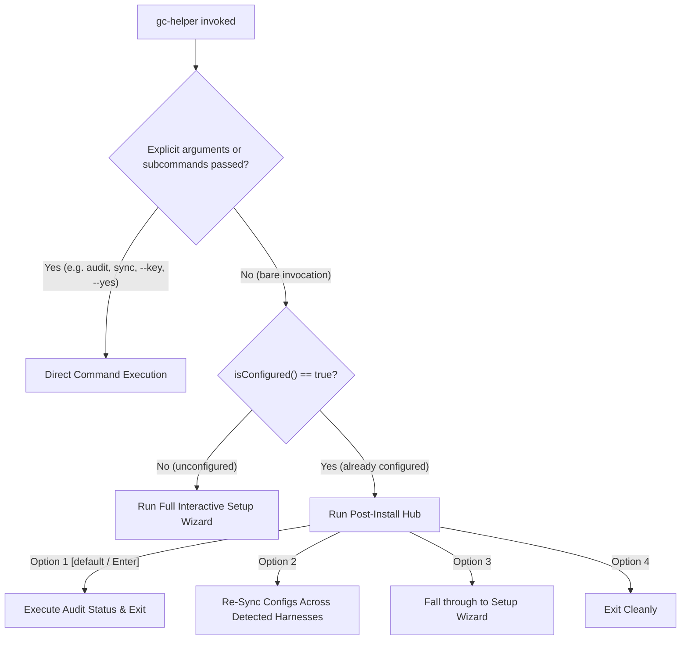

# Design: Configured State Detection & Status Management Hub for GC-Helper

## Objective
Prevent `gc-helper` from re-prompting for the Base URL and API Key on subsequent executions once GhostCLI is already configured on the system. When already configured, running `gc-helper` (no args) defaults directly to a status readout and provides a lightweight management hub.

## Architecture & Lifecycle

## Configured Detection Logic
A system is classified as **configured** if:
1. `detectExistingKey()` resolves a GhostCLI API key (`gcli_...`) from environment or tool settings, OR
2. At least one installed harness has an existing GhostCLI or custom endpoint configured in its config file (`settings.json`, `config.toml`, `config.yaml`, `openclaw.json`).
