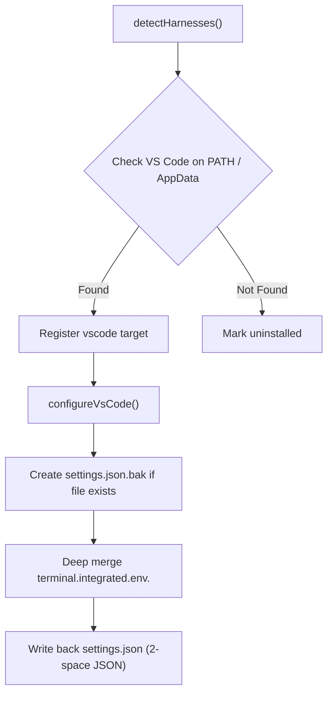

# Design: Visual Studio Code Terminal Integration

## Objective
Enable `gc-helper` to automatically detect Microsoft Visual Studio Code across Windows, macOS, and Linux, and inject GhostCLI endpoint and API key settings into VS Code's `settings.json` under `terminal.integrated.env.<os>`.

## Context & Architecture
When users launch CLI tools (such as `claude`, `codex`, `openclaw`, or Python/Node scripts) from inside VS Code's integrated terminal, those processes inherit environment variables defined in VS Code's user `settings.json`.

## Platform Keys
- **Windows**: `terminal.integrated.env.windows`
- **macOS**: `terminal.integrated.env.osx`
- **Linux**: `terminal.integrated.env.linux`

## Injected Variables
- `ANTHROPIC_BASE_URL`: Root GhostCLI URL (e.g. `https://ghostcli.cloud`)
- `OPENAI_BASE_URL`: OpenAI v1 compatible URL (e.g. `https://ghostcli.cloud/v1`)
- `GHOSTCLI_API_KEY`: Active API key (`gcli_...`)
- `ANTHROPIC_API_KEY`: Active API key (`gcli_...`)
